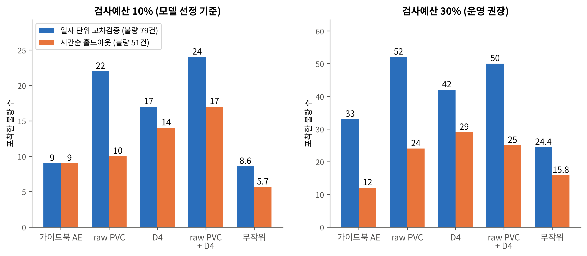

# Focuspot

### 약지도학습 기반 로봇 점용접 불량 예측 · 검사 우선순위 추천

🏆 **제6회 K-인공지능 제조데이터 분석 경진대회 최우수상 · POSTECH 총장상**

**팀 CACADACA · 신현호, 김두용**

날짜별 불량 개수만 기록된 제조 데이터에서 타점별 불량 위험 순위를 만들고, 제한된 검사예산 안에서 먼저 확인할 타점을 추천하는 프로젝트입니다. 불량 위험도 예측부터 검사 계획, 공정 조건 탐색, 결과 기록까지 연결합니다.



## 주요 기능

| 기능 | 내용 |
| --- | --- |
| 불량 위험 순위 | 타점별 정답 대신 날짜별 불량 개수로 학습하는 raw PVC MLP |
| 규칙 결합 | 그날 중앙값에서 벗어난 정도를 계산하는 D4와 학습 모델의 날짜별 순위 백분위를 평균 |
| 검사 우선순위 | 하루 검사예산 5~30%에 맞춰 우선검사 대상을 추천 |
| 공정 조건 탐색 | 전류·전압·통전시간·가압력과 파생 변수를 분석하고 날짜별 분포 범위를 표시 |
| 시연 화면 | 생산 흐름, 우선검사 목록, 검사 결과 입력·CSV 내보내기, 기준 갱신 |

## 바로 보기

1. 저장소를 내려받습니다.
2. **[시연 화면 HTML](소스코드/ui/점용접_검사우선순위_모니터.html)**을 브라우저로 엽니다. GitHub 파일 화면에서는 내려받은 뒤 열어야 합니다.
3. 생산일과 검사예산을 선택하고, 우선검사 목록과 가상 검사 결과를 확인합니다.

HTML에는 시연 데이터가 포함되어 있어 Python 설치와 원본 데이터 없이 열 수 있습니다. 검사 기록은 해당 브라우저에 저장됩니다.

**시연 범위:** 부품 형상·타점 위치·불량 위치는 가상 값입니다. 날짜별 실제 불량 개수와 외부 데이터 검증 포착률을 이용해 시연용 불량 위치를 배치했습니다. 화면의 검사 결과를 KAMP 타점별 실제 적발 성능으로 해석하지 않습니다. 표시한 공정 범위는 관측 분포의 가운데 95% 구간이며, 품질이 보장된 공정 허용범위가 아닙니다.

## 최종 모델

| 단계 | 방법 |
| --- | --- |
| 입력 | 전류·전압·통전시간·가압력과 입열량(V·I·t), 동저항(V/I), 전류/가압력(I/F) |
| raw PVC | 날짜별 불량 개수만 사용하는 MLP · 10개 시드 결과 평균 |
| D4 | 파생 변수의 수준 이탈·이동 중앙값 편차·직전 변화량을 날짜별 강건 통계로 요약하는 규칙 |
| 결합 | raw PVC와 D4의 날짜 안 순위 백분위를 1:1 평균 |
| 추천 | 날짜 안 결합점수가 높은 타점부터 검사예산만큼 선택 |

학습·평가 분할은 날짜 단위로 수행하며 같은 날이 양쪽에 포함되지 않도록 구성했습니다. 최종 결합점수는 **검사 우선순위를 위한 점수**입니다.

## 결과

### KAMP 적용

- 전체 **11,939타점** 중 복사 블록으로 표시된 **1,164타점**은 별도 품질확인 대상으로 분리했습니다.
- 순위 대상 **10,775타점**에 위험 순위를 부여했습니다.
- 하루 검사예산 30% 기준 우선검사 대상은 9일 합계 **3,235타점**입니다.
- KAMP에는 타점별 정답이 없으므로 타점별 포착률은 이 데이터로 채점할 수 없습니다.

[타점별 예측결과](테스트데이터_예측결과.csv) · [일별 30% 검사 계획](소스코드/budget_repro/results/b30_kamp_daily_plan.csv)

### 외부 데이터 검증 · Stellantis N.V.

타점별 라벨을 숨긴 뒤 날짜별 불량 개수만 남겨 학습하고, 숨겨 둔 라벨로 채점했습니다. 외부 데이터를 KAMP에 합치거나 외부 데이터의 학습 가중치를 KAMP로 옮기지 않았습니다.

| 평가 | 검사예산 | raw PVC + D4 포착 | 전체 불량 | 포착률 | 같은 예산의 무작위 기대 포착 |
| --- | --- | --- | --- | --- | --- |
| 날짜 단위 교차검증 | 10% | 24건 | 79건 | 30.4% | 8.6건 |
| 날짜 단위 교차검증 | 30% | 50건 | 79건 | 63.3% | 24.4건 |
| 시간순 홀드아웃 | 10% | 17건 | 51건 | 33.3% | 5.7건 |
| 시간순 홀드아웃 | 30% | 25건 | 51건 | 49.0% | 15.8건 |

대회 제출본의 저장 결과입니다. [원본 결과표](소스코드/budget_repro/results/err_budget_table.csv)와 [모델별 비교표](소스코드/budget_repro/results/b30_model_capture.csv)를 함께 제공합니다. 예산·분할에 따라 단일 모델과 결합 모델의 우열은 달라집니다.

## 저장소 구성

| 경로 | 내용 |
| --- | --- |
| `소스코드/exp/` | 1차 후보 모델·입력 비교, 데이터 로딩과 약지도학습 공용 모듈 |
| `소스코드/budget_repro/` | 검사예산 평가, 최종 결합 모델, 타당성·안정성·오류 분석 |
| `소스코드/budget_repro/results/` | 결과 CSV·분석 문서 · pickle 캐시는 제외 |
| `소스코드/budget_repro/figures/` | 보고서에 사용한 실험 그림 |
| `소스코드/EDA/` | KAMP·Stellantis N.V.·Querétaro 데이터 진단 |
| `소스코드/ui/` | 시연용 HTML, 템플릿, 화면 데이터 생성 코드 |
| `학습용 데이터/` | 데이터 출처·이용 조건 문서 · 원본 데이터는 제외 |
| `docs/REPRODUCIBILITY.md` | 대회 제출 당시 실행·실험 안내 |
| `docs/DATASET_SETUP.md` | 데이터 배치와 공개 저장소에서의 재현 범위 |

## 실행

### 화면 재생성

저장된 결과 CSV에서 HTML을 다시 만듭니다. 원본 데이터·GPU·PyTorch가 필요하지 않습니다.

```bash
python -m pip install numpy pandas
python 소스코드/ui/build_ui.py
```

### 모델 학습·실험 재현

먼저 [데이터 준비 안내](docs/DATASET_SETUP.md)에 따라 원본 데이터를 배치합니다. 전체 실험 환경은 제출본의 `requirements.txt`를 보존했습니다.

```bash
python -m pip install -r requirements.txt
python 소스코드/run_all.py --exp
```

원본 데이터와 생성 캐시를 생략했으므로, 저장된 pickle 점수가 필요한 후속 분석만 단독 실행하면 파일 누락 오류가 날 수 있습니다. 학습 단계부터 순서대로 실행해야 합니다. 버전·장치에 따른 재현 차이는 [원본 실행 안내](docs/REPRODUCIBILITY.md#재현-확인)에 기록되어 있습니다.

## 데이터 출처

| 데이터 | 용도 | 출처·이용 조건 |
| --- | --- | --- |
| KAMP 용접기 AI 데이터셋 | 분석·예측 대상 | 대회 제공 데이터. 원본은 이용 권한을 확보한 뒤 준비 |
| Stellantis N.V. / Politecnico di Torino | 타점별 라벨을 숨긴 외부 검증 | [공개 저장소](https://github.com/smartdatapolito/resistance_spot_welding_dataset) · 원본 출처 문서상 CC BY-NC 4.0 |
| Querétaro RSW | 물리 관계 확인 · 최종 모델 학습·성능 평가에는 미사용 | [Mendeley Data V3](https://doi.org/10.17632/rwh8kjzdch.3) · 원본 출처 문서상 CC BY 4.0 |

자세한 서지 정보와 활용 범위는 [데이터 출처 문서](학습용%20데이터/데이터_출처.md)를 참고하세요. 이 저장소는 제3자 데이터에 새로운 라이선스를 부여하지 않습니다.
