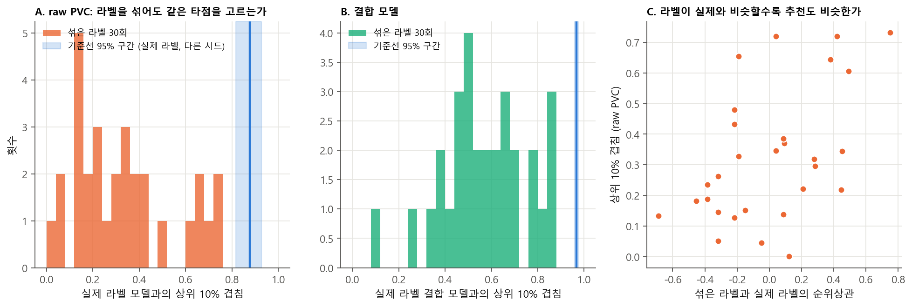
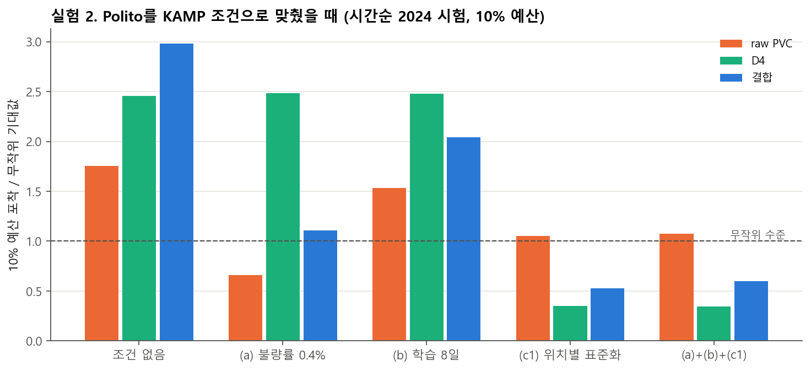

# KAMP 타당성 검증 보고서 — "그래서 KAMP 데이터에서 되는가"

작성: 2026-10-05 · 대상 코드: `budget_repro/` 노트북 22~25, `br/validity.py` · 독자: 기계공학 전공자

## 결론 (실험별 한 줄)

- **재현 확인** — 기존 핵심 수치 두 개가 그대로 재현됐다(Stellantis N.V. 시간순 10% 결합 17/51, KAMP 시드 묶음 겹침 0.849). 새로 학습한 점수가 기존 캐시와 완전히 같다.
- **실험 1 (KAMP 라벨 섞기)** — raw PVC는 KAMP 라벨에 **반응한다**. 라벨을 섞으면 추천이 크게 바뀐다(겹침 0.31 vs 기준선 0.88). "저전류 구간 쏠림"도 라벨에서 나온다. 그러나 이 반응이 **옳은 방향인지는 KAMP 안에서 확인할 방법이 없다.**
- **실험 2 (Stellantis N.V.를 KAMP 조건으로)** — 불량률 0.4%, 학습 8일, 위치 효과 제거를 모두 적용하면 **세 모델 모두 무작위와 같거나 그보다 나쁘다**(결합 10% 예산 −4.4%p [−6.5, −2.1]).
  - 불량률만 낮춰도 raw PVC는 무작위 아래로 떨어진다.
  - 위치 효과만 빼도 D4와 결합이 무너진다.
  - 지금까지 Stellantis N.V.에서 보인 성능은 KAMP에 없는 조건(불량률 4%, 위치 간 차이)에 기대고 있었다.
- **실험 3 (1장과의 정합성)**
  - F1·PR-AUC·AUROC로 봐도 원래 조건의 결론은 같다.
  - 가이드북 AE는 무작위 수준이고, 결합이 날짜 하나 빼기 평가에서 유의하게 더 많이 찾는다.
  - Stellantis N.V. 2022년 가압력 결측 타점은 학습 행 중앙값으로 채워졌다. 시간순 결과는 이 타점이 학습에 있느냐에 크게 흔들린다(결합 17 → 8).

**종합:** 심사에서 "KAMP 데이터에서 되는가"라는 질문에 "된다"고 답할 근거는 이번 검증에서 **나오지 않았다.** 정직하게 답할 수 있는 범위는 다음과 같다.
1. 이 방법은 불량률이 수 %이고 타점 위치마다 조건이 다른 공정(Stellantis N.V.)에서는 무작위보다 많이 찾는다.
2. KAMP와 같은 조건(불량률 0.4%, 날짜 8개, 위치 정보 없음)으로 맞추면 그 효과가 사라진다.
3. 그래서 KAMP에는 추천 목록을 검사 순서 후보로 제시하고, 현장 검증으로 확인해야 한다.

---

## 0. 용어

| 용어 | 뜻 |
|---|---|
| 라벨(정답) | KAMP에서는 날짜별 불량 개수. 타점별 정상·불량은 없다 |
| raw PVC | 날짜별 불량 개수만으로 학습하는 작은 신경망(MLP, 층이 두 개인 비선형 회귀식). 입력은 전류·전압·통전시간·가압력과 입열량·동저항·전류/가압력 |
| D4 | 학습하지 않는 규칙. 파생 변수 9개가 그날 중앙값에서 얼마나 벗어났는지(강건 z 점수 절댓값)를 더한 값 |
| 결합 | 날짜마다 raw PVC와 D4 점수를 순위 백분위로 바꿔 평균한 값(최종 권장 모델) |
| 시드 | 신경망 초기값을 정하는 난수 번호. 10개 시드로 학습해 점수를 평균한다 |
| 상위 10% 겹침 | 두 모델이 날짜마다 고른 상위 10% 타점 중 같은 타점의 비율. 1이면 완전히 같은 타점을 고른다 |
| 날짜 하나 빼기(LODO) | 날짜 하나를 빼고 나머지로 학습해 뺀 날짜를 평가 |
| 시간순 평가 | 2022~23년 14일로 학습 → 2024년 5일(931타점, 불량 51)을 추천 |
| AUROC | 불량 타점과 정상 타점을 하나씩 뽑았을 때 불량에 더 높은 점수를 줄 확률. 0.5가 무작위 |
| 같은 위치 안 AUROC | 같은 타점 위치끼리만 비교한 AUROC. 위치 간 조건 차이의 효과를 뺀 판별력 |
| PR-AUC | 정밀도(추천 중 불량 비율)–재현율(불량 중 추천된 비율) 곡선 아래 면적. 무작위 기준값은 불량률 |
| F1 | 정밀도와 재현율의 조화평균 |
| 95% 구간 | 차체(또는 날짜·반복)를 복원추출해 계산한 범위. 차이 구간이 0을 포함하면 무작위와 구분되지 않는다 |

---

## 1. 재현 확인 (`22_repro_check`)

| 항목 | 기존 | 재현 |
|---|---:|---:|
| Stellantis N.V. 시간순, 10% 예산, 결합 | 17/51 | **17.0/51** |
| KAMP raw PVC 시드 0~4 평균 vs 5~9 평균, 상위 10% 겹침 | 0.849 | **0.849** |
| 새로 학습한 KAMP 점수와 기존 캐시의 최대 차이 | – | 0.0 |

같은 환경임을 확인했고, 학습은 결정적이다(같은 시드면 같은 결과).

**재현 중 발견한 문서 오류:** 보고서 v2 7.3절의 "전류가 **그날** 중앙값보다 0.1 kA 이상 낮음 83.1%"는 실제로는 **9일 전체 중앙값** 기준으로 계산된 값이었다(`18_kamp_deep.py`의 `med = out.loc[ok, ...].median()`). 이번 보고서는 두 기준을 모두 적는다.

---

## 2. 실험 1 — KAMP 라벨 섞기 검정 (`23_kamp_label_shuffle`)

### 설계 (실행 전 고정)
- 8일의 불량 개수 [4, 8, 7, 4, 5, 4, 4, 3]을 날짜끼리 무작위로 섞었다. 합계 39는 유지하고, 실제와 같은 배열은 뺐다. 30회, 순열 난수 시드 2026이다. 섞은 배열은 `results/exp1_label_sets.csv`에 있다.
- 매회 raw PVC를 같은 사양으로 학습했다(시드 0~9 평균).
- **주 분석은 8일 전체로 1회 학습**해 9일 전체 타점에 점수를 매겼다(시드당 약 2초). 원래 추천 목록 방식(날짜 하나 빼기)으로 30회를 돌리면 약 82분이 걸려, 날짜 하나 빼기는 **10회로 줄여** 확인했다.
- 대조군 "고정 불량률 라벨"은 날짜마다 round(39 × 그날 타점 수 / 8일 타점 수)다. 반올림 때문에 합계가 **41**이 됐다.
- 기준선은 실제 라벨로 시드 0~9와 10~19를 각각 학습한 두 모델의 겹침이다(같은 라벨에서 시드만 바뀔 때의 흔들림).
- 판정 기준(고정)
  - 섞은 라벨 겹침 30개의 중앙값이 기준선 구간 하한 이상 → "배운 것이 없다".
  - 30개의 97.5 백분위가 기준선 구간 하한보다 낮음 → "라벨 정보를 쓴다".
  - 그 사이 → "일부".

### 결과: 상위 10% 추천 겹침

| 비교 | raw PVC | 결합 |
|---|---:|---:|
| 기준선: 실제 라벨, 시드만 다름 (평균 [날짜 복원추출 95%]) | **0.877** [0.818, 0.928] | **0.967** [0.958, 0.975] |
| 섞은 라벨 30회 vs 실제 라벨 (중앙값 [2.5, 97.5 백분위]) | **0.307** [0.032, 0.724] | **0.554** [0.208, 0.856] |
| 고정 불량률 라벨 vs 실제 라벨 (평균 [95%]) | 0.186 [0.149, 0.225] | 0.411 [0.370, 0.450] |
| (확인) 날짜 하나 빼기 기준선 | 0.825 [0.731, 0.900] | 0.894 [0.861, 0.927] |
| (확인) 날짜 하나 빼기, 섞은 라벨 10회 | 0.295 [0.123, 0.537] | 0.562 [0.443, 0.747] |

**판정: raw PVC와 결합 모두 "라벨 정보를 쓴다".** 섞은 라벨의 97.5 백분위(0.724)도 기준선 하한(0.818)보다 낮다. 날짜 하나 빼기에서도 같다. 결합은 D4가 라벨과 무관해서 덜 바뀐다.

섞은 라벨이 실제 라벨과 비슷할수록(순위상관이 클수록) 추천도 비슷했다(순위상관과 겹침의 상관 0.42, 그림 20-C). 모델이 라벨을 따라간다는 또 하나의 근거다.

### 결과: "저전류 구간 쏠림"은 어디서 나오는가

추천 상위 10% 가운데 전류가 기준보다 0.1 kA 이상 낮은 타점의 비율(복사 블록 제외, 9일)이다.

| 모델 | 그날 중앙값 기준 | 전체 중앙값 기준 (기존 83.1% 정의) |
|---|---:|---:|
| raw PVC · 실제 라벨 | **0.842** [0.582, 1.000] | 0.998 [0.994, 1.000] |
| raw PVC · 섞은 라벨 30회 (중앙값 [2.5, 97.5 백분위]) | 0.480 [0.058, 0.834] | 0.616 [0.054, 0.987] |
| raw PVC · 고정 불량률 라벨 | 0.196 [0.129, 0.252] | 0.284 [0.219, 0.373] |
| 결합 · 실제 라벨 | 0.725 [0.488, 0.885] | 0.879 [0.798, 0.949] |
| 결합 · 섞은 라벨 30회 | 0.471 [0.182, 0.703] | 0.585 [0.224, 0.849] |
| 결합 · 고정 불량률 라벨 | 0.314 [0.217, 0.381] | 0.399 [0.357, 0.451] |

저전류 쏠림은 데이터 모양만으로 생기지 않는다. 날짜마다 불량률이 같다고 가르치면 20% 수준으로 떨어진다. 쏠림은 **실제 라벨 배열에서 생긴 것**이다.

그런데 단순한 날짜 단위 관계로는 설명되지 않는다. 날짜별 저전류 타점 비율(전체 중앙값 − 0.1 kA 미만)과 일별 불량률의 순위상관은 8일에서 0.14다. 예를 들어 3/25는 불량이 8개로 가장 많지만 저전류 비율은 0.24로 낮고, 4/07은 불량이 3개인데 저전류 비율은 0.57로 가장 높다. 모델이 라벨의 어떤 차이를 저전류 쪽으로 연결했는지는 이번 실험으로 밝히지 못했다.

### 해석 (중요)
"라벨에 반응한다"는 "라벨에서 맞는 것을 배웠다"와 다르다. 학습에 쓰인 날짜가 8개뿐이다. 그래서 모델은 날짜 8개의 불량 수 차이를 설명하는 아무 조건(여기서는 그날의 저전류 구간)이나 잡을 수 있다. KAMP 안에서 이 반응이 맞는지 볼 수 있는 유일한 근거는 날짜 하나 빼기 날짜 단위 확인(이전 18번)이었다. 거기서 고위험 비율과 일별 불량률의 순위상관은 −0.02(p 0.52)였다. **라벨에 반응하지만, 그 반응이 다음 날에도 맞는다는 근거는 없다.**

---

## 3. 실험 2 — Stellantis N.V.를 KAMP 조건으로 맞춘 검증 (`24_polito_kamp_conditions`)

### 설계 (실행 전 고정)
- 기본 평가는 시간순(2022~23년 14일 학습 → 2024년 5일 추천)이다. 모델 사양은 그대로다.
- (a) **불량률 0.4%:** 불량 타점을 확률 0.1로만 남겨 학습 개수와 시험 정답을 함께 줄였다. **100회**(요청 200회에서 축소, 1회 약 18초). 난수 시드 1000+r.
- (b) **학습 8일:** 학습 14일 중 8일을 무작위로 골랐다. 30조합.
- (c1) **입력 위치 효과 제거:** raw PVC 입력 7개와 D4의 파생 변수 9개를 타점 위치별로 표준화했다(위치 평균을 빼고 위치 표준편차로 나눔, 정답 미사용). 1회.
- (c2) **채점 위치 효과 제거:** 모든 조건을 같은 위치 안 AUROC로도 채점했다.
- (a)+(b)+(c1): 세 가지를 동시에 적용. 100회(요청 200회에서 축소).
- 95% 구간: 반복이 있는 조건은 반복 단위 복원추출, 1회 조건은 시험 차체 9대 복원추출.

### 결과: 10% 예산 (찾은 불량 / 같은 수 무작위, 무작위 대비 포착률 차이 [95%])

| 조건 | raw PVC | D4 | 결합 |
|---|---|---|---|
| 조건 없음 (불량 51) | 10.0/5.7, +8.5%p [−2.9, +17.9] | 14.0/5.7, **+16.4%p** [+9.0, +21.6] | 17.0/5.7, **+22.2%p** [+7.8, +34.4] |
| (a) 불량률 0.4% (100회, 불량 합 479) | 35.0/53.2, **−3.8%p** [−6.1, −1.3] | 132.0/53.2, **+16.5%p** [+12.5, +20.6] | 59.0/53.2, +1.2%p [−2.2, +5.0] |
| (b) 학습 8일 (30조합, 불량 합 1,530) | 260.0/169.6, **+5.9%p** [+3.4, +8.5] | 420.0/169.6, +16.4%p (*) | 346.7/169.6, **+11.6%p** [+8.9, +14.4] |
| (c1) 위치별 표준화 (불량 51) | 6.0/5.7, +0.7%p [−9.4, +18.4] | 2.0/5.7, **−7.2%p** [−10.1, −3.3] | 3.0/5.7, −5.2%p [−10.2, +3.4] |
| **(a)+(b)+(c1)** (100회, 불량 합 526) | 62.0/57.7, +0.8%p [−1.9, +3.6] | 20.0/57.7, **−7.2%p** [−8.8, −5.4] | 34.7/57.7, **−4.4%p** [−6.5, −2.1] |

(*) D4는 학습이 없어 (b)에서 매회 같은 값이다. 그래서 반복 복원추출 구간의 폭이 0이 되어 의미가 없다. 구간은 "조건 없음" 행의 차체 복원추출 구간을 본다.

5%·20% 예산도 같은 양상이다(`results/exp2_conditions.csv`).
- 5%: (a) raw PVC −1.2%p [−3.3, +1.1], 결합 −0.1%p. (abc) 결합 −2.6%p [−4.1, −1.1].
- 20%: (a) raw PVC −3.9%p [−7.2, −0.2]. (abc) 결합 −7.0%p [−9.9, −3.9].

### 결과: AUROC와 같은 위치 안 AUROC

| 조건 | raw PVC (AUROC / 같은 위치 안) | D4 | 결합 |
|---|---|---|---|
| 조건 없음 | 0.583 / 0.490 [0.311, 0.644] | 0.709 / 0.519 [0.412, 0.634] | 0.686 / 0.495 [0.369, 0.595] |
| (a) | 0.430 / 0.510 | 0.700 / 0.517 | 0.613 / 0.505 |
| (b) | 0.541 / 0.489 | 0.709 / 0.519 | 0.672 / 0.503 |
| (c1) | 0.581 / 0.490 [0.290, 0.674] | 0.390 / 0.558 [0.417, 0.722] | 0.467 / 0.519 [0.385, 0.667] |
| (a)+(b)+(c1) | 0.517 / 0.521 | 0.394 / 0.542 | 0.415 / 0.519 |

같은 위치 안 AUROC의 구간은 1회 조건(조건 없음, c1)만 차체 복원추출로 계산했다. 반복 조건은 반복 평균만 냈다(아래 "실행하지 못한 것" 참고).

### 해석
- **같은 위치 안에서는 어떤 모델도 불량을 구분하지 못한다**(모든 조건에서 0.49~0.56, 구간이 0.5를 포함). Stellantis N.V.에서 보인 성능은 거의 전부 "불량이 잦은 위치의 조건 수준"을 알아본 결과다.
- **D4도 예외가 아니다.** 입력에서 위치 효과를 빼자 무작위보다 나빠졌다(−7.2%p). D4가 날짜 안에서 "벗어난" 타점을 고를 때, Stellantis N.V.에서는 그것이 "다른 위치의 타점"이었다는 뜻이다.
- **raw PVC는 불량률이 낮으면 개수 학습이 무너진다.** 4%에서 0.4%로 줄이면 학습 날짜 대부분의 불량 수가 0~1개가 된다. 이때 모델은 방향을 잡지 못했다(AUROC 0.43). KAMP 불량률이 바로 이 수준이다.
- 학습 날짜를 8개로 줄이는 것은 상대적으로 덜 치명적이다.
- KAMP 조건을 모두 적용하면 결합은 무작위보다 유의하게 낮다. **Stellantis N.V. 검증 결과를 KAMP 성능의 근거로 옮겨 쓸 수 없다.**

---

## 4. 실험 3 — 보고서 1장과의 정합성 (`25_consistency`)

### 4.1 F1 · PR-AUC · AUROC (Stellantis N.V., 원래 조건)

- F1 기준 (i) 날짜별 상위 c개(c = 그날 실제 불량 수. 선택 수가 불량 수와 같아 정밀도 = 재현율 = F1)
- F1 기준 (ii) 날짜별 상위 10%
- PR-AUC·AUROC는 날짜마다 점수를 순위 백분위로 바꿔 모아서 계산했다(날짜 하나 빼기에서는 날짜마다 모델이 다르기 때문)
- 구간은 차체 복원추출

| 평가 | 모델 | 10% 찾은 불량 | F1 (상위 c개) | F1 (10%) | 정밀도/재현율 (10%) | PR-AUC (무작위) | AUROC |
|---|---|---:|---|---|---|---|---|
| 날짜 하나 빼기 | raw PVC | 22/79 | 0.203 [0.086, 0.342] | 0.154 [0.079, 0.232] | 0.107 / 0.278 | 0.081 [0.048, 0.128] (0.040) | 0.696 [0.612, 0.754] |
| | D4 | 17/79 | 0.152 [0.060, 0.293] | 0.119 [0.073, 0.167] | 0.083 / 0.215 | 0.070 [0.043, 0.109] | 0.657 [0.596, 0.711] |
| | **결합** | 24/79 | 0.266 [0.135, 0.395] | 0.168 [0.090, 0.247] | 0.117 / 0.304 | 0.103 [0.058, 0.165] | 0.699 [0.605, 0.761] |
| | 가이드북 AE | 9/79 | 0.114 [0.024, 0.271] | 0.063 [0.023, 0.107] | 0.044 / 0.114 | 0.048 [0.034, 0.074] | 0.543 [0.468, 0.623] |
| 시간순 2024 | raw PVC | 10/51 | 0.176 [0.035, 0.405] | 0.137 [0.051, 0.229] | 0.105 / 0.196 | 0.103 [0.050, 0.198] (0.055) | 0.574 [0.452, 0.628] |
| | D4 | 14/51 | 0.216 [0.094, 0.432] | 0.192 [0.134, 0.244] | 0.147 / 0.275 | 0.132 [0.089, 0.225] | 0.700 [0.638, 0.775] |
| | **결합** | 17/51 | 0.275 [0.086, 0.478] | 0.233 [0.125, 0.334] | 0.179 / 0.333 | 0.136 [0.077, 0.258] | 0.684 [0.612, 0.744] |
| | 가이드북 AE | 9/51 | 0.176 [0.031, 0.404] | 0.123 [0.057, 0.195] | 0.095 / 0.176 | 0.064 [0.038, 0.121] | 0.511 [0.406, 0.607] |

F1은 0.12~0.28로 낮다. 불량률이 4~5%인 자료에서 추천 10% 중 불량은 11~18%뿐이다. 이 숫자들은 위치 효과가 살아 있는 원래 조건의 값이다(실험 2 참고).

### 4.2 가이드북 AE vs 결합 (같은 입력 4개, 같은 예산)

AE 구성: 4→3→2→3→4, 활성화 함수 RReLU, 손실 MSE, Adam 학습률 0.01, 50 epoch, batch 64, 학습 행 기준 MinMax 정규화. 10시드 평균. 정답을 쓰지 않는다.

| 평가 | 예산 | 결합 | 가이드북 AE | 무작위 | 결합 − AE 포착률 [95%] |
|---|---|---:|---:|---:|---|
| 날짜 하나 빼기 | 5% | 18.5 | 5.0 | 4.9 | **+16.9%p** [+5.9, +27.0] |
| | 10% | 24.0 | 9.0 | 8.6 | **+18.6%p** [+1.7, +32.1] |
| | 20% | 38.0 | 22.0 | 16.0 | **+19.9%p** [+2.3, +36.1] |
| 시간순 2024 | 5% | 9.0 | 4.0 | 3.4 | +9.2%p [−4.5, +19.0] |
| | 10% | 17.0 | 9.0 | 5.7 | +15.3%p [−4.3, +34.3] |
| | 20% | 21.0 | 10.0 | 10.3 | +21.2%p [0.0, +38.3] |

가이드북 AE는 두 평가 모두 무작위와 거의 같다. 결합은 날짜 하나 빼기에서 AE보다 유의하게 많이 찾는다. 시간순에서는 차이가 커도 구간이 0을 포함한다. 단, 이 비교도 위치 효과가 살아 있는 원래 조건이다.

### 4.3 Stellantis N.V. 2022년 가압력 0 타점

**확인한 사실(코드)**
- 2022년 타점 136개는 모두 가압력 파형이 0이다. 요약값 단계에서 결측(NaN)으로 바뀐다(`wl/data.py`의 `_summ`). 2023~24년에도 148개(1,840개 중)가 결측이다.
- raw PVC: `spec._prep`가 가압력과 I/F(전류/가압력)의 결측을 **학습 행의 중앙값**으로 채운 뒤 표준화한다. 시간순이면 2023년 타점의 중앙값이다. 이 채운 값이 2022년 타점 전체에 똑같이 들어간다.
- D4: I/F 수준값 결측은 전체 중앙값으로 채워진다. 같은 날 안에서 모두 같은 값이라 |z| = 0이 된다. I/F의 편차·변화량은 0으로 채워진다. 확인 결과 2022년 타점의 D4 I/F 성분 합 최댓값은 0.0이다. **2022년 타점의 D4는 입열량·동저항 6개 성분만으로 계산된다.**

**민감도 (10% 예산, 같은 표본 대응 비교, 차체 복원추출 95%)**

| 평가 | 설정 | raw PVC | D4 | 결합 |
|---|---|---|---|---|
| 시간순 2024 (불량 51) | 원래 | 10 | 14 | 17 |
| | (i) 2022년 136타점을 학습에서 제외 | 4 (−11.3%p [−20.3, −1.7]) | 14 (변화 없음) | **8 (−17.5%p [−27.8, −6.1])** |
| | (ii) 가압력·I/F 중립화(상수) | 13 (+6.2%p [0.0, +15.8]) | 13 (−1.9%p [−5.4, 0.0]) | 14 (−6.0%p [−11.5, −1.4]) |
| 날짜 하나 빼기, 2022년 날짜 제외 채점 (불량 72) | 원래 | 22 | 17 | 24 |
| | (i) 2022년 제외 | 23 (+1.4%p [0.0, +4.8]) | 17 | 24 (0.0%p) |
| 날짜 하나 빼기 (불량 79) | 원래 | 22 | 17 | 24 |
| | (ii) 가압력·I/F 중립화 | 17 (−6.4%p [−13.3, 0.0]) | 16 (−1.2%p [−5.7, +3.1]) | 25 (+1.2%p [−4.3, +6.7]) |

**해석**
- 날짜 하나 빼기 결과는 두 처리 모두에 둔감하다.
- 시간순 결과는 2022년 타점을 학습에서 빼면 크게 떨어진다(결합 17 → 8). 다만 2022년을 빼면 학습 날짜가 14일에서 4일로 줄어든다. 그래서 "가압력 결측 처리" 때문인지 "학습 날짜 감소" 때문인지 분리되지 않는다.
- 가압력 관련 변수를 중립화하면 시간순 결합이 3개 줄어든다(구간이 0을 포함하지 않음).
- 시간순 10%의 "17/51"은 이런 처리 선택에 3~9개 정도 흔들리는 수치다.

---

## 5. 보고서에 쓸 수 있는 주장 / 쓸 수 없는 주장

### 쓸 수 있는 주장
1. Stellantis N.V.(불량률 약 4%, 위치별 조건 차이가 있는 공정)에서 결합 모델은 같은 검사량으로 무작위보다 많은 불량을 찾았다(시간순 10% 17/51 vs 5.7, +22.2%p [+7.8, +34.4]). 가이드북 AE는 무작위 수준이었다.
2. 그 성능은 같은 위치 안의 판별이 아니라 **위치 간 조건 차이**에서 나왔다. 같은 위치 안 AUROC는 0.49~0.52다.
3. raw PVC는 KAMP의 날짜별 불량 개수에 반응한다. 라벨을 섞으면 추천이 바뀌고(겹침 0.31 vs 0.88), 저전류 구간 쏠림도 라벨에서 나온다.
4. KAMP와 같은 조건(불량률 0.4%, 학습 8일, 위치 정보 없음)으로 Stellantis N.V.를 맞추면 모든 모델이 무작위와 같거나 그보다 나빠졌다. 불량률이 낮으면 개수 학습이 무너지고, 위치 정보가 없으면 규칙(D4)도 효과가 없다.
5. 따라서 KAMP 추천 목록은 **검증되지 않은 검사 순서 후보**다. 실제 효과는 현장 검증(추천 타점 검사 결과 기록)으로 확인해야 한다.

### 쓸 수 없는 주장
1. "KAMP에서 10% 검사로 불량의 약 1/3을 찾는다." Stellantis N.V. 수치를 KAMP로 옮기는 것은 실험 2로 반박된다.
2. "모델이 KAMP 라벨에서 불량 조건을 학습했다." 라벨에 반응하는 것은 맞지만, 그 반응이 맞다는 근거가 없다(날짜 단위 확인 순위상관 −0.02).
3. "낮은 전류(그날 중앙값보다 0.1 kA 이상 낮음)가 불량 위험 조건이다." 원인은 물론 연관도 KAMP에서 검증되지 않았다. 또 기존 83.1%는 "그날"이 아니라 "전체" 중앙값 기준이었다.
4. "파생 변수 5종 규칙(D4)이 시기 변화에 강하다." Stellantis N.V.에서는 맞지만 위치 효과에 기댄 결과였고, 위치 효과를 빼면 무작위보다 나쁘다.
5. "결합 모델이 가이드북 AE보다 KAMP에서 낫다." 비교는 Stellantis N.V. 원래 조건에서만 했다.

---

## 6. 실행한 것 / 실행하지 못한 것

**실행한 것**
- 재현 확인 2개(캐시와 점수 일치 확인 포함)
- 실험 1
  - 주 분석: 8일 전체 학습. 실제 라벨 20시드, 섞은 라벨 30회 × 10시드, 고정 불량률 라벨 10시드
  - 확인: 날짜 하나 빼기. 실제 라벨 시드 10~19 추가, 섞은 라벨 10회 × 10시드
- 실험 2: 조건 없음, (a) 100회, (b) 30조합, (c1) 1회, (c2) 전 조건, (a)+(b)+(c1) 100회. 모두 시간순 평가, raw PVC는 매회 10시드
- 실험 3: F1·PR-AUC·AUROC(두 평가 × 4모델), 가이드북 AE(두 평가, 10시드), 2022년 가압력 처리 확인과 민감도 2종(두 평가)

**실행하지 못했거나 줄인 것**
- 실험 1 날짜 하나 빼기를 30회가 아니라 **10회**만 했다(시간: 30회면 약 82분).
- 실험 2의 (a)와 (a)+(b)+(c1)을 200회가 아니라 **100회**만 했다(1회 약 18초).
- 실험 2는 **시간순 평가만** 했다. 날짜 하나 빼기 평가에서 같은 조건은 돌리지 않았다.
- 실험 2 반복 조건의 같은 위치 안 AUROC는 반복 평균만 냈고 95% 구간은 계산하지 않았다.
- 실험 2 (b)의 D4 구간은 반복 간 변화가 없어 의미가 없다(본문 표 주석).
- 실험 3의 2022년 제외 민감도에서 "가압력 결측 효과"와 "학습 날짜 감소 효과"를 분리하는 추가 실험은 하지 않았다(새 조건 탐색이 되므로).

**고정한 난수 시드:** 모델 시드 0~9(실제 라벨 기준선 10~19), 라벨 순열 2026, 불량 줄이기 1000+r, 학습 8일 선택 2007+r, (a)+(b)+(c1) 3000+r(날짜 선택 3007+r). 복원추출 시드는 각 노트북에 적었다.

**새 결과 파일** (기존 파일은 수정하지 않았다)
- 실험 1: `exp1_label_sets.csv`, `exp1_fullfit_scores.pkl`, `exp1_lodo_scores.pkl`, `exp1_main_overlap.csv`, `exp1_main_lowcurrent.csv`, `exp1_lodo_overlap.csv`, `exp1_lodo_lowcurrent.csv`, `exp1_supplement_ci.csv`
- 실험 2: `exp2_runs.pkl`, `exp2_conditions.csv`, `exp2_withinloc_ci.csv`
- 실험 3: `exp3_scores.pkl`, `exp3_metrics.csv`, `exp3_ae_vs_combined.csv`, `exp3_force_sensitivity.csv`, `exp3_force_sensitivity_ci.csv`
- 그림: `figures/20_exp1_label_shuffle.png`, `figures/21_exp2_conditions.png`
