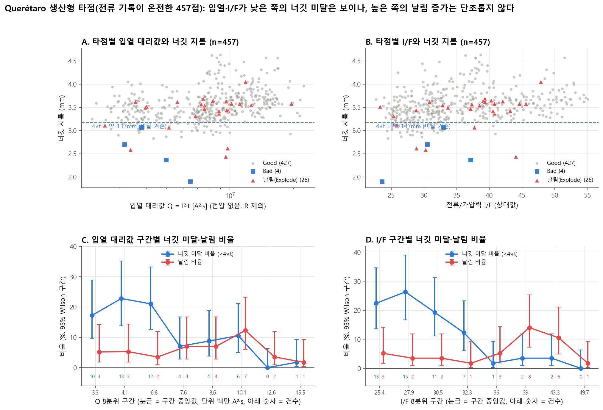
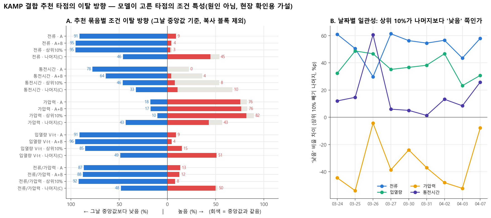
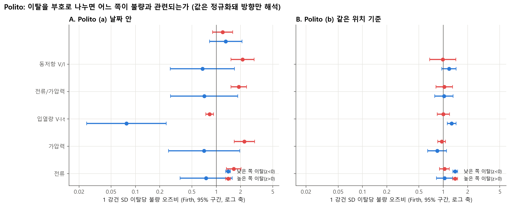

# Querétaro 물리 근거와 KAMP 추천 타점의 이탈 방향 대조

작성일 2026-10-05 · 노트북 `26_queretaro_physics`, `27_kamp_direction`, `28_polito_sign` · 공통 통계 함수 `br/stat.py`

---

## 한눈에 보기: 작업별 결론

| 작업 | 결론 |
|---|---|
| 시작 전 확인 | 기존 수치 두 개를 그대로 재현했다(날림 24/332 대 2/130, p=0.0137 / ρ=+0.378). 필터는 `Comments = DOE` 33타점 제외(462타점)다. 단 지정 경로 `외부데이터셋/`과 README.md는 없었다. 데이터는 `제조 AI 기획서/02_Queretaro_RSW/`에 있었다. |
| 1. 실험 구조 | 설계 요인은 가압력 2수준(60·80psi), 통전시간 5수준(400~1,200ms), 전극 각도 2수준(0°·15°)이다. **전류를 바꾼 조건은 없다**(설정값 열 없음). 전압·저항도 없다. 80psi는 각도 0°·600~1,000ms에만 있어 가압력과 각도가 섞여 있다. |
| 2. 조건별 품질 방향 | 확인된 것: 통전시간 증가 → 너깃 지름·인장 하중 증가, 너깃 미달 감소. 가압력 증가 → 날림 감소, 너깃 지름 감소, 너깃 미달 증가. **전류**는 같은 조건 안의 자연 변동으로만 볼 수 있었다. 너깃 미달과 같은 방향의 경향은 있으나 통계적으로 확인되지 않았다(p=0.054). |
| 3. 파생 변수 | 입열 대리값(I²·t)과 I/F가 낮은 쪽에서 너깃 미달이 늘어나는 **아래쪽 경계는 보인다.** 입열이 높은 쪽에서 날림이 늘어나는 **위쪽 경계는 보이지 않는다.** 날림은 입열보다 가압력 60psi·특정 조건 칸에 몰려 있다. |
| 4. KAMP 추천 방향 | 추천 타점(A, A+B, 상위 10%)의 85~96%는 그날 중앙값보다 전류·입열이 낮고, 76~82%는 가압력이 높다. 9일 모두 같은 방향이다. 두 방향 모두 '용접부족 의심' 쪽이다. 근거 수준은 가압력 쪽이 (가), 전류 쪽이 (나)다. |
| 5. 유형별 개수 비교 | 모델은 유형별 개수를 보지 않았다(총 개수만 사용). 크기 영향을 뺀 주 분석에서는 **입열 낮음 추천과 용접부족 사이에 관계가 없었다**(비율 대 비율 ρ=−0.08, p=0.84). A·A+B 등급에서 보인 ρ≈0.74~0.77은 등급 크기가 총 불량 수와 같게 정해진 데서 오는 기계적 상관이다. 총 불량 수만으로도 ρ=0.72가 나온다. |
| 6. Stellantis N.V. 방향 | 위치를 통제하지 않으면 '높은 쪽 이탈이 위험'으로 보인다. 같은 위치 기준으로 바꾸면 **입열량이 낮은 쪽만** 불량과 관련됐다(오즈비 1.27/SD [1.12, 1.44]). 이 방향은 Querétaro의 아래쪽 경계, KAMP 추천의 방향과 같다. 나머지 변수에서는 방향이 없었다. |

---

## 0. 데이터와 원칙

- **Querétaro**(Domínguez 외 2025, Mendeley Data V3): `Data_RSW.csv` 1개 파일이다. 타점마다 약 100ms 간격의 전류·힘 측정값 1~16행과 실측 품질(인장 하중, 너깃 지름, Good/Bad/Explode 판정)이 들어 있다. IR·RGB 사진도 있으나 쓰지 않았다.
  - 생산형 462타점(판 두께 약 0.63mm, AISI 1010)만 썼다. 이 가운데 5타점은 전류 샘플 수가 통전시간에 비해 모자라(통신 오류 2건 포함), 전류를 쓰는 분석에서는 457타점만 썼다.
  - 첫 샘플은 통전이 막 시작되는 상승 구간이라 평균이 낮다(약 1,950A, 이후 샘플은 2,700~3,700A). 그래서 전류는 둘째 샘플부터 평균했다.
- **절대값은 비교하지 않는다.** Querétaro(psi, A, 수백 ms)와 KAMP(bar, kA, 약 72ms)는 설비와 단위가 다르다. 방향(높은 쪽인지 낮은 쪽인지)과 상대적 이탈만 쓴다.
- Querétaro로 모델을 학습하거나 평가하지 않았다. 기존 노트북, 기존 results 파일, 추천 결과는 수정하지 않았다.
- **크기의 차이도 알고 있어야 한다.** Querétaro는 통전시간을 3배, 가압력을 1.33배 바꾼 실험이다. KAMP 추천 타점의 이탈은 그날 중앙값 대비 전류 약 −0.14kA(약 −1%), 가압력 약 +0.03~0.04bar(약 +1.5%)로 훨씬 작다. 방향이 같다는 것은 작은 이탈에서도 같은 효과가 난다는 증거가 아니다.

**통계 용어 풀이** (이후 처음 나올 때 다시 짧게 적는다)

- 95% 구간: 같은 실험을 반복하면 참값이 이 범위에 들어갈 것으로 보는 범위다. 0이나 1(비율이면 1)을 포함하면 방향을 확정할 수 없다.
- p값: 효과가 없다고 가정했을 때 이 정도 차이가 우연히 나올 확률이다.
- 오즈비(OR): 사건 확률비의 근사다. 1보다 크면 그 방향으로 사건이 늘어난다.
- Spearman ρ(순위상관): 두 값의 크기 순서가 얼마나 같이 움직이는지를 −1~+1로 나타낸다.

---

## 1. Querétaro 실험 구조 (작업 1)

**조합별 타점 수 (생산형 462타점)**

| 가압력 | 각도 | 400ms | 600ms | 800ms | 1,000ms | 1,200ms | 합계 |
|---|---|---:|---:|---:|---:|---:|---:|
| 60psi | 0° | 50 | – | – | 22 | 30 | 102 |
| 60psi | 15° | 49 | 51 | 50 | 50 | 30 | 230 |
| 80psi | 0° | – | 50 | 51 | 29 | – | 130 |
| 합계 | | 99 | 101 | 101 | 101 | 60 | 462 |

- 전체 결과: Good 432, 날림(Explode) 26, Bad 4.
- 가압력과 각도가 섞여 있다. 80psi는 모두 0°이고, 600~1,000ms에만 있다. 두 가압력을 같은 각도·같은 통전시간에서 비교할 수 있는 칸은 **(1,000ms, 0°) 하나뿐**이다(60psi 22타점, 80psi 29타점).
- **전압·저항 측정값: 없다.** 측정 시계열은 전류(A)와 힘(Force 열, N 표기)뿐이다. 힘 값은 60psi에서 약 69~98, 80psi에서 약 104~115다. 공압 가압력으로 보기에는 작아 상대값으로만 썼다.
- **전류를 바꾼 조건: 없다.** 전류 설정값 열이 없고, 설계 요인은 가압력·통전시간·각도 셋이다.
  - 측정 전류는 조건 칸마다 평균이 2,873~3,749A로 다르다(Kruskal 검정 p=8.8×10⁻⁵¹, 여러 묶음의 분포가 같은지 보는 검정).
  - 같은 칸 안에서도 평균 268A 정도 흩어진다(전체 변동계수 12.9%).
  - 칸 사이의 차이는 가압력·시간·각도, 또는 기록되지 않은 실험 회차와 분리할 수 없다. 그래서 **전류 효과는 같은 조건 칸 안의 자연 변동으로만 추정했다.** 이것은 조건을 바꾼 실험 근거가 아니라 관찰 근거다.

---

## 2. 조건별 품질 방향 (작업 2)

- 너깃 미달은 4√t 기준(t = 판 두께, 약 3.17mm) 아래인 경우로 정의했다. 자동차 업계에서 흔히 쓰는 최소 너깃 지름 기준을 빌린 것이며, 이 데이터셋의 판정 기준은 아니다. 462타점 중 51건이다.
- 통제 결과는 다음 방법으로 냈다.
  - 연속값(너깃·인장): 최소제곱 회귀를 썼다. 95% 구간은 HC3 강건 표준오차(값의 흩어짐이 조건마다 달라도 쓸 수 있는 표준오차)로 구했다.
  - 이진값(날림·Bad·미달): Firth 로지스틱(사건이 드물거나 어떤 칸에 사건이 0건이어도 계수가 발산하지 않는 로지스틱 회귀)을 썼다.
  - "고정효과"는 칸마다 기준선을 따로 두어, 칸 사이 차이를 효과 추정에서 빼는 방식이다.
- 전체 표(단순 분석 포함)는 `queretaro_direction_table.csv`에 있다.

**표 2-1. 다른 조건을 통제한 방향**

| 조건 (단위) | 통제 방법 | 너깃 지름 | 인장 하중 | 너깃 미달 | 날림 | Bad 판정 (4건) | n |
|---|---|---|---|---|---|---|---:|
| 통전시간 (+200ms당) | 가압력×각도 층 고정효과 | **증가** +0.09mm [+0.07, +0.12] | **증가** +65N [+47, +83] | **감소** OR 0.62 [0.47, 0.83] | 방향 없음 OR 0.82 [0.62, 1.09] | 방향 없음 OR 0.78 [0.45, 1.35] | 462 |
| 가압력 (80 대 60psi) | 각도 + 통전시간 고정효과 (가산 가정) | **감소** −0.30mm [−0.42, −0.19] | **감소** −188N [−264, −113] | **증가** OR 13.5 [2.9, 61.9] | **감소** OR 0.15 [0.03, 0.93], p=0.041 | 방향 없음 OR 0.58 [0.02, 14.9] | 462 |
| 측정 전류 (+100A당) | 조건 칸(11개) 고정효과, 칸 안 변동만 사용 | 방향 없음 +0.011 [−0.006, +0.028] | 방향 없음 +9.7N [−3.3, +22.8] | 방향 없음 OR 0.90 [0.81, 1.00], p=0.054 | 방향 없음 OR 0.94 [0.83, 1.06] | 방향 없음 OR 0.86 [0.70, 1.06] | 457 |
| 전극 각도 (15° 대 0°, 참고) | 가압력 + 통전시간 고정효과 | 방향 없음 | 방향 없음 (p=0.058) | 방향 없음 | 방향 없음 OR 1.01 [0.31, 3.31] | 방향 없음 | 462 |

**단순 비교에서 달라지는 점** (통제 전후를 함께 봐야 하는 이유)

- 측정 전류는 통제하지 않으면 너깃 +0.013mm/100A [+0.006, +0.021], 미달 OR 0.84 [0.77, 0.91]로 "유의"하게 나온다. 하지만 칸 사이 차이를 빼면 사라진다. 이는 다른 조건과 섞인 결과다.
- 각도 15°는 단순 비교에서 날림 OR 2.77 [1.17, 6.58]이었다. 가압력·시간을 통제하면 1.01로 사라진다. 15°는 60psi에만 있었기 때문이다.

**가압력과 날림 — 각도 혼재를 감안한 층별 비교**

| 비교 | 60psi 날림 | 80psi 날림 | 차이(80−60) [95%] | Fisher p | 너깃 차이(80−60) |
|---|---|---|---|---:|---|
| 전체 | 24/332 (7.2%) | 2/130 (1.5%) | −5.7%p [−9.2, −1.2] | 0.014 | −0.22mm [−0.28, −0.16] |
| 각도 0°만 | 5/102 (4.9%) | 2/130 (1.5%) | −3.4%p [−9.5, +1.4] | 0.245 | −0.23mm [−0.33, −0.13] |
| (1,000ms, 0°) 칸 | 0/22 | 0/29 | 판단 불가 | 1.0 | −0.63mm [−0.81, −0.45] |

- 비정상(Bad+날림)으로 넓히면 각도 0°만 비교해도 7.8% 대 1.5%(p=0.024)다.
- **판단:** "가압력이 낮으면 날림이 많다"는 방향은 일관된다. 다만 각도를 같게 맞추면 날림만으로는 유의하지 않다. 그래서 (가)로 분류하되 이 조건을 붙인다.
- "가압력이 높으면 너깃이 작다"는 유일한 공존 칸에서도 −0.63mm로 뚜렷하다. 문헌의 설명(가압력이 높으면 접촉 저항이 줄어 발열이 줄어듦)과 같은 방향이다.

**통전시간 층별 Spearman ρ (통전시간–너깃)**

| 층 | 60psi·0° | 60psi·15° | 80psi·0° | 전체 |
|---|---|---|---|---|
| 너깃 | +0.51 [+0.33, +0.66] | +0.36 [+0.24, +0.48] | +0.10 [−0.08, +0.26] | +0.38 [+0.30, +0.45] |
| 인장 | +0.40 [+0.20, +0.57] | +0.59 [+0.50, +0.67] | +0.32 [+0.16, +0.47] | +0.45 [+0.37, +0.51] |

- 80psi 층(600~1,000ms)에서는 너깃 증가가 뚜렷하지 않다.
- 통전시간별 날림은 400ms 6/99, 600ms 10/101, 800ms 6/101, 1,000ms 0/101, 1,200ms 4/60이다. **통전시간이 길수록 날림이 늘지 않는다.**

**확인 불가 항목:** 전류를 설정값으로 바꾼 효과(실험 없음). Bad 판정과의 관계는 4건뿐이라 모든 조건에서 구간이 넓어 판단할 수 없다.

---

## 3. 파생 변수의 물리적 의미 (작업 3)

- **입열 대리값 Q = (본 구간 전류의 제곱평균) × 통전시간 [A²·s].** 전압이 없어 발열 공식 Q=I²Rt에서 저항 R을 뺀 **대리값**이다.
  - Q의 변동은 주로 통전시간에서 온다(log Q와 통전시간 ρ=+0.85, 전류 ρ=+0.72).
  - 같은 조건 칸 안에서 Q가 달라지는 것은 전류 변동 때문이다.
- **I/F = 평균 전류 / 측정 힘 중앙값**(상대값).

*그림 1. Querétaro 457타점. 위: 타점별 Q·I/F와 너깃 지름(파란 점선 = 4√t). 아래: 8분위 구간별 너깃 미달·날림 비율(95% Wilson 구간, 아래 숫자 = 건수).*

**표 3-1. 1 표준편차(SD) 증가당 오즈비 (Firth 로지스틱)**

| 변수 | 결과 | 단순 | 가압력·각도 통제 | 같은 칸 안 | 날림 2차항(U자 여부) |
|---|---|---|---|---|---|
| log Q | 너깃 미달 (51건) | **0.52 [0.39, 0.70]** | **0.45 [0.31, 0.66]** | 0.43 [0.19, 1.01], p=0.052 | – |
| log Q | 날림 (26건) | 0.94 [0.64, 1.39] | 0.87 [0.60, 1.27] | 0.55 [0.20, 1.55] | 2차 계수 −0.18 [−0.58, +0.22] |
| log I/F | 너깃 미달 | **0.33 [0.22, 0.50]** | **0.36 [0.21, 0.60]** | 0.52 [0.27, 1.01], p=0.054 | – |
| log I/F | 날림 | 1.23 [0.84, 1.81] | 0.77 [0.48, 1.26] | 0.55 [0.24, 1.26] | 2차 계수 −0.23 [−0.66, +0.20] |

**아래쪽 경계 (입열 부족 → 너깃 미달): 보인다.**

- Q 하위 3개 구간에서 너깃 미달은 17~23%(10·13·12건)다. 상위 2개 구간에서는 0~2%(0·1건)다.
- 가압력·각도를 통제해도 남는다. 같은 칸 안(전류 주도 변동)에서도 같은 방향이지만 경계선이다(p=0.052).

**위쪽 경계 (입열 과다 → 날림): 보이지 않는다.**

- 날림 비율은 Q 6번째 구간에서 12%(7/57)로 가장 높다. 그러나 최상위 구간에서는 1.8%(1/57)로 내려간다.
- 선형 효과와 2차 효과 모두 유의하지 않다.
- 날림은 조건 칸에 몰려 있다. 60psi·15°·600ms 9/51(17.6%), 60psi·0°·1,200ms 4/30, 60psi·15°·400ms 5/49, 60psi·15°·800ms 5/50이고, 1,000ms 세 칸은 모두 0건이다.
- 칸 11개 단위로 보면 날림률과의 순위상관은 Q −0.28, I/F +0.07, 전류 +0.27이다.

**해석:** 이 데이터의 실험 범위 안에서 날림은 입열 크기보다 가압력(60psi)과 조건 칸에 좌우됐다. "입열이 과하면 날림"은 문헌상 알려진 현상이다. 하지만 Querétaro로는 확인되지 않았다. 실험 범위가 날림 영역까지 충분히 가지 않았을 수도 있다.

---

## 4. KAMP 추천 타점의 이탈 방향 (작업 4)

**대상과 기준**

- `final_kamp_recommendations_combined.csv`에서 복사 블록(품질확인) 1,164행을 뺀 10,775타점을 썼다(9일, 3/27은 추정 개수 6개 기준 등급 포함).
- 추천 묶음: A등급 45, A+B등급 225, 상위 10% 1,079.
- 방향은 그날 순위 대상 타점의 중앙값과 비교했다. KAMP 값은 0.01 단위로 기록돼 중앙값과 같은 값이 많다(통전시간 56%, 가압력 14%, 전류 9%). 그래서 '같음'을 따로 셌다.
- 입열량은 KAMP에 전압이 있으므로 V·I·t(1장 정의)를 썼다. Querétaro와 같은 대리값 I²·t도 같은 결과를 냈다(`kamp_direction_by_group.csv`).
- 비율 차이의 95% 구간은 타점이 서로 독립이라고 가정한 값이다. KAMP 전류는 생산 순서상 이웃 타점끼리 거의 같아서(시차 1 자기상관 0.95) 실제 불확실성은 이보다 크다. 그래서 **9일 중 며칠에서 같은 방향인지**를 함께 봤다.

*그림 2. A: 추천 묶음별로 그날 중앙값보다 낮은(파랑)·높은(빨강)·같은(회색) 타점 비율. B: 날짜별로 상위 10%의 '낮음' 비율에서 나머지의 '낮음' 비율을 뺀 값.*

**표 4-1. 그날 중앙값보다 '낮은' 타점 비율 (%)**

| 변수 | A | A+B | 상위 10% | 나머지(상위 10% 밖) | 같은 방향인 날 (상위 10%) |
|---|---:|---:|---:|---:|---:|
| 전류 | 91 | 95 | 95 | 42 | 9/9 |
| 통전시간 | 78 | 64 | 46 | 32 | 9/9 |
| 가압력 | 18 | 17 | 10 | 46 | 0/9 (반대로 높은 쪽 82%) |
| 입열량 V·I·t | 91 | 96 | 85 | 46 | 9/9 |
| 전류/가압력 | 87 | 88 | 92 | 44 | 9/9 |

- 그날 중앙값과의 차이(중앙값 기준)는 전류 −0.14~−0.16kA, 가압력 +0.03~+0.04bar다. A·A+B의 통전시간은 −1ms다.
- "뚜렷한 이탈"(그날 강건 z ≤ −1, 즉 중앙값에서 흩어짐 척도 1배 이상 아래)도 같은 방향이다. 상위 10%에서 전류 77%(나머지 20%), 입열량 45%(15%)다.
- 동저항 V/I(참고)는 추천의 96~100%가 높은 쪽이다. 전압이 거의 일정해서(하루 표준편차 0.004~0.019V) 전류가 낮으면 V/I가 기계적으로 높아진다.

**의심 불량 유형 규칙**

규칙은 Querétaro 결과(2·3절)와 문헌으로 먼저 정한 뒤 적용했다. README에 "추천의 83%는 저전류"라는 사실이 이미 적혀 있었다는 점은 밝혀 둔다.

- 주 의심 유형은 입열 방향으로 정한다. 입열 낮음 → 용접부족 의심, 입열 높음 → 파임·크랙 의심.
- 가압력 방향은 보조 표시로 붙인다. 가압력 높음 → 너깃 작아짐(용접부족) 의심, 가압력 낮음 → 날림을 거친 파임 의심.
- 타점별 결과는 `kamp_recommendations_suspect_type.csv`(상위 10% 1,079타점, A+B 225타점은 모두 이 안에 포함)에 있다.
- KAMP 불량 유형의 정의는 데이터에 없다. 그래서 이름(파임불량·용접부족·크랙발생)으로만 해석했다.

### ▶ 핵심 표 (보고서 3장용): 조건 이탈 방향 × 의심 불량 유형 × 근거 수준 × KAMP 추천 중 비율

근거 수준

- **(가)** Querétaro 실측으로 확인됨
- **(나)** 문헌·발열 공식(Q=I²Rt)에 근거, Querétaro로는 미확인
- **(다)** 근거 없음

| 조건 | 이탈 방향 (그날 중앙값 대비) | 의심 불량 유형 | 근거 수준 | Querétaro에서 실제로 본 것 | A 중 | A+B 중 | 상위 10% 중 | 나머지(C) 중 |
|---|---|---|---|---|---:|---:|---:|---:|
| 입열량 | 낮음 | 용접부족 | **(가)** 통전시간이 이끄는 입열 / **(나)** 전류가 이끄는 입열 | Q 낮을수록 너깃 미달↑ (통제 OR 0.45/SD). 같은 칸 안(전류 주도) p=0.052 | 91% | 96% | 85% | 49% |
| 입열량 | 높음 | 파임·크랙 | (나) | 날림 증가 없음. 파임·크랙은 측정하지 않음 | 9% | 4% | 15% | 51% |
| 전류 | 낮음 | 용접부족 | (나) | 같은 칸 안 미달 OR 0.90/100A [0.81, 1.00]: 방향은 같으나 미확인. 전류를 바꾼 실험 없음 | 91% | 95% | 95% | 46% |
| 전류 | 높음 | 파임(날림) | (나) | 같은 칸 안 날림 OR 0.94: 증가 없음 | 9% | 4% | 3% | 45% |
| 통전시간 | 짧음 | 용접부족 | **(가)** | +200ms당 너깃 +0.09mm, 미달 OR 0.62 | 78% | 64% | 46% | 33% |
| 통전시간 | 김 | 파임·크랙 | (나) | 날림 OR 0.82: 증가 없음 | 0% | 4% | 8% | 10% |
| 가압력 | 낮음 | 파임 (날림을 거쳐) | **(가)** 날림까지 / (나) 날림→파임 | 60psi 날림 7.2% 대 80psi 1.5%. 각도 0°만 보면 p=0.25 | 18% | 17% | 10% | 43% |
| 가압력 | 높음 | 용접부족 | **(가)** | 80psi 너깃 −0.30mm, 미달 OR 13.5 [2.9, 62] | 76% | 76% | 82% | 43% |
| 전류/가압력 | 높음 | 파임(날림) | (나) | 통제 시 날림 OR 0.77: 증가 없음 | 13% | 12% | 8% | 50% |
| 전류/가압력 | 낮음 | 용접부족 | **(가)** 단, 가압력 차이가 이끔 | I/F 낮을수록 미달↑ (통제 OR 0.36/SD), 같은 칸 안 p=0.054 | 87% | 88% | 92% | 48% |

*KAMP 비율은 모델이 고른 타점의 조건 특성이다. 불량의 원인이 아니라 현장에서 확인할 가설이다. Querétaro와 KAMP의 이탈 크기는 수십 배 차이 난다(0절).*

- **요약:** 추천 타점은 "전류·입열 낮음 + 가압력 높음" 쪽에 있다. 두 방향 모두 Querétaro와 문헌으로 보면 '발열 부족 → 용접부족' 쪽이다.
- 상위 10% 기준 근거 수준의 구성: 통전시간까지 짧아 (가)가 붙는 입열 부족 498, 전류만 낮아 (나)인 입열 부족 421, 입열 높음 (나) 160.
- 파임·크랙 쪽 방향(입열·전류 높음, 가압력 낮음)은 추천에서 3~18%로, 나머지 타점(43~51%)보다 오히려 적다.

---

## 5. KAMP 불량 유형별 개수와의 비교 (작업 5)

**모델이 유형별 개수를 봤는가: 보지 않았다.**

- `exp/wl/kamp.py`의 `load_kamp()`는 `result` 시트의 `defect`를 날짜별로 합한 **총 개수**만 반환한다(`res.groupby(날짜)["defect"].sum()`).
- raw PVC는 이 총 개수로 학습했다. 게다가 날짜 하나 빼기 방식이라 그날의 총 개수도 보지 않았다. D4는 정답을 쓰지 않는다.
- budget_repro 안에서 `defect type`을 읽는 코드는 없다. 예전 `exp/09_typed_physics_model.py`만 유형별 개수를 썼다.
- **주의:** A등급 크기는 그날 총 불량 수(c_d), B등급은 5c_d로 정해진다(`21_kamp_report_fig.py`). 그래서 A·A+B의 "추천 개수"는 총 개수와 기계적으로 연결된다. 주 분석은 크기가 날짜 비율로 정해지는 상위 10%와, 묶음 안의 방향 **비율**로 했다.

**날짜별 유형 개수 (정답 있는 8일)**

| 날짜 | 03-24 | 03-25 | 03-26 | 03-30 | 03-31 | 04-02 | 04-03 | 04-07 |
|---|---:|---:|---:|---:|---:|---:|---:|---:|
| 파임 | 2 | 3 | 3 | 1 | 2 | 1 | 2 | 0 |
| 용접부족 | 1 | 2 | 2 | 2 | 3 | 1 | 1 | 1 |
| 크랙 | 1 | 3 | 2 | 1 | 0 | 2 | 1 | 2 |
| 상위 10% 중 입열 낮음 비율 | 0.79 | 0.93 | 0.92 | 0.83 | 0.84 | 0.92 | 0.71 | 0.78 |

**표 5-1. 날짜 8개 순위상관과 정확 순열 검정**

정확 순열 검정은 8개 날짜의 짝을 바꾸는 40,320가지 경우를 모두 계산해, 실제 상관이 우연히 나올 확률을 구하는 방법이다. 아래 p값은 다중 비교 보정을 하지 않은 값이다.

| 구분 | 비교 | ρ | p (양측) | p (단측, 기대 방향) |
|---|---|---:|---:|---:|
| 주 분석 | 상위 10% 입열낮음 수 대 용접부족 수 | +0.40 | 0.31 | 0.16 |
| 주 분석 | 상위 10% 입열높음 수 대 파임+크랙 수 | −0.66 | 0.08 | 0.96 (반대 방향) |
| 주 분석 | 상위 10% 입열높음 수 대 파임 / 대 크랙 | −0.49 / −0.75 | 0.22 / 0.046 | 0.90 / 0.98 (반대 방향) |
| 주 분석 (비율) | 상위 10% 입열낮음 비율 대 용접부족 비율 | −0.08 | 0.84 | 0.59 |
| 주 분석 (비율) | 상위 10% 전류낮음 비율 대 용접부족 비율 | +0.04 | 0.94 | 0.47 |
| 주 분석 (비율) | A+B 입열낮음 비율 대 용접부족 비율 | +0.22 | 0.61 | 0.32 |
| 참고 (크기 연동) | A 입열낮음 수 대 용접부족 수 | +0.74 | 0.054 | 0.032 |
| 참고 (크기 연동) | A+B 입열낮음 수 대 용접부족 수 | +0.77 | 0.043 | 0.021 |
| 교차 대조 | A 입열낮음 수 대 파임+크랙 수 | +0.51 | 0.21 | – |
| 기준 | **총 불량 수 대 용접부족 수** | **+0.72** | 0.057 | 0.043 |
| 기준 | 총 불량 수 대 A 입열낮음 수 | +0.90 | 0.004 | – |
| 기준 | 하루 타점 수 대 상위 10% 입열낮음 수 | +0.98 | <0.001 | – |

**판단: 유형별 개수로는 근거를 얻지 못했다.**

- A·A+B에서 보인 양의 상관(+0.74~0.77)은 "총 불량 수 대 용접부족 수"(+0.72)와 같은 크기다. A등급은 거의 전부 입열 낮음이라, A 입열낮음 수 ≈ 총 불량 수다. 따라서 방향 정보가 더해졌다는 증거가 아니다.
- 상위 10% 개수는 하루 생산량(타점 수)과 거의 같이 움직인다(ρ=+0.98).
- 크기 영향을 뺀 비율 분석에서는 관계가 없다.
- 크랙과의 음의 상관(−0.75, p=0.046)은 기대와 반대 방향이다. 30개 가까운 비교 가운데 하나라 우연일 가능성을 배제할 수 없다.
- **판별력 한계:** 날짜가 8개뿐이다. 단측 p<0.05가 되려면 ρ가 약 +0.64 이상이어야 한다. 유형별 개수도 하루 0~3건이고, 용접부족 비율은 0.25~0.60 사이의 몇 개 값뿐이다. "관계 없음"은 "관계가 없다는 증거"가 아니라 "이 데이터로는 판별할 수 없다"는 뜻이다.

---

## 6. Stellantis N.V.에서 방향 확인 (작업 6)

**방법**

- D4와 같은 날짜 안 강건 z를 부호로 나눴다. 강건 z는 중앙값과 MAD(중앙값 절대편차)로 표준화한 값이라 이상값에 덜 흔들린다.
- 낮은 쪽 이탈과 높은 쪽 이탈을 한 Firth 로지스틱에 함께 넣어 각각의 오즈비를 구했다.
- 위치 교란을 피하려고 (b) 같은 위치(전 기간) 중앙값 기준 z도 냈다.
- 같은 위치 안 AUROC도 구했다. AUROC는 불량 타점의 z가 양품보다 클 확률이다. 0.5보다 크면 높은 쪽이, 작으면 낮은 쪽이 위험하다는 뜻이다. 구간은 차체 단위 복원추출 200회로 구했다.
- 값이 정규화돼 있어 방향만 본다. 가압력이 0인 284타점은 가압력·I/F 분석에서 뺐다.
- 같은 위치 기준 통전시간은 위치 안 흩어짐이 0인 곳이 대부분이라 18타점만 남았다. 그래서 판단하지 않았다.

*그림 3. Stellantis N.V.에서 1 강건 SD 이탈당 불량 오즈비. A: 날짜 안 기준. B: 같은 위치 기준.*

| 변수 | (a) 날짜 안: 낮은 쪽 OR | (a) 높은 쪽 OR | (a) 판정 | (b) 같은 위치: 낮은 쪽 OR | (b) 높은 쪽 OR | (b) 같은 위치 안 AUROC | (b) 판정 |
|---|---|---|---|---|---|---|---|
| 전류 | 0.75 [0.36, 1.58] | 1.65 [1.34, 2.03] | 높은 쪽 | 1.04 [0.82, 1.31] | 1.03 [0.90, 1.19] | 0.475 [0.363, 0.558] | 방향 없음 |
| 통전시간 | 0.71 [0.26, 1.95] | 2.23 [1.66, 2.98] | 높은 쪽 | (n=18, 판단 불가) | | | – |
| 가압력 | 0.08 [0.02, 0.24] | 0.83 [0.74, 0.93] | 방향 없음 (가운데가 위험) | 0.84 [0.64, 1.10] | 0.96 [0.85, 1.07] | 0.584 [0.487, 0.706] | 방향 없음 |
| 입열량 V·I·t | 0.71 [0.27, 1.85] | 1.90 [1.52, 2.38] | 높은 쪽 | **1.27 [1.12, 1.44]** | 1.00 [0.84, 1.19] | **0.393 [0.273, 0.492]** | **낮은 쪽** |
| 전류/가압력 | 0.67 [0.27, 1.68] | 2.12 [1.52, 2.95] | 높은 쪽 | 1.02 [0.79, 1.32] | 1.03 [0.81, 1.30] | 0.465 [0.360, 0.554] | 방향 없음 |
| 동저항 V/I | 1.31 [0.83, 2.08] | 1.20 [0.90, 1.60] | 방향 없음 | 1.18 [0.96, 1.44] | 0.98 [0.68, 1.43] | 0.464 [0.340, 0.582] | 방향 없음 |

- **(a) 날짜 안 기준의 "높은 쪽이 위험"은 위치 교란으로 보인다.** 같은 계산에서 같은 위치 안 AUROC는 0.42~0.53으로 0.5 부근이거나 0.5 아래다. 팀이 이미 확인한 "Stellantis N.V.의 전류·에너지–불량 관계는 위치 교란"과 같은 현상이다. 이 결과로 "전류·입열이 높으면 불량"이라고 쓰면 안 된다.
- **(b) 같은 위치 기준에서는 입열량이 낮은 쪽만 불량과 관련됐다.** 같은 위치 안 AUROC 0.39의 구간이 0.5를 넘지 않는다. 낮은 쪽 오즈비의 p는 약 0.0002로, 12개 비교에 대한 Bonferroni 보정(여러 번 검정한 만큼 기준을 엄격하게 하는 방법) 후에도 남는다.
- 나머지 변수(전류·가압력·I/F·동저항)는 위치를 통제하면 방향이 없다.
- **Querétaro와의 일치:**
  - 입열 낮음 → 불량: Stellantis N.V. (b)와 Querétaro 아래쪽 경계가 **같은 방향**이다. 단 Stellantis N.V. 불량은 유형이 없는 초음파 판정이라 '용접부족'인지는 모른다.
  - 전류 단독 방향: 두 데이터 모두 확인되지 않았다.
  - 입열 높음 → 불량: 두 데이터 모두 보이지 않았다(Stellantis N.V.는 위치 통제 후).

---

## 7. 보고서에 쓸 수 있는 주장 / 쓸 수 없는 주장

**쓸 수 있는 주장**

1. Querétaro 실험에서 통전시간이 길수록 너깃 지름과 인장 하중이 커지고 너깃 미달이 줄었다(층 통제 후에도 같음).
2. Querétaro에서 가압력 80psi는 60psi보다 날림이 적었다(1.5% 대 7.2%). 대신 너깃이 0.3mm 작았다. 단 80psi는 각도 0°에만 있어, 각도를 맞춘 날림 비교는 유의하지 않았다.
3. Querétaro에서 입열 대리값(I²·t)이 낮은 쪽에 너깃 미달이 몰리는 아래쪽 경계가 관찰됐다. 전압이 없어 대리값이라는 점을 함께 적는다.
4. KAMP 결합 모델이 고른 추천 타점은 9일 모두 그날 중앙값보다 전류·입열이 낮고 가압력이 높은 쪽에 몰려 있다(상위 10%의 95%·85%·82%).
5. 이 이탈 방향은 Querétaro·문헌 기준으로 '발열 부족 → 용접부족' 방향과 일치한다. 따라서 추천 타점은 **용접부족 여부를 먼저 확인할 현장 가설**로 제시할 수 있다(가압력 쪽 근거 (가), 전류 쪽 근거 (나)).
6. Stellantis N.V.에서 위치를 통제하면 입열량이 낮은 쪽 이탈만 불량과 관련됐다. 이는 위 방향과 같다.
7. 모델은 유형별 불량 개수를 학습에 쓰지 않았다. 유형별 개수와의 날짜 단위 대조에서는 근거를 얻지 못했고, 날짜 8개라 판별력이 낮다.

**쓸 수 없는 주장**

1. "전류가 불량을 가른다", "전류가 낮아서 불량이 생겼다": Querétaro에는 전류를 바꾼 실험이 없다. 같은 조건 안의 전류 변동은 p=0.054로 확인되지 않았다. KAMP 추천은 모델이 고른 것이다.
2. "입열이 과하면 날림·파임·크랙이 생긴다는 것을 데이터로 확인했다": Querétaro에서 위쪽 경계가 보이지 않았고, 파임·크랙은 측정되지 않았다. 문헌 근거 (나)로만 쓴다.
3. "KAMP 추천 타점의 의심 유형이 실제 불량 유형과 맞았다": 유형별 개수 대조에서 근거가 없었다. A등급의 상관은 등급 크기 때문이다.
4. Querétaro 수치(psi, A, ms)로 KAMP의 안전 조건이나 허용 범위를 정하는 것: 설비·단위·이탈 크기가 다르다. 4장 안정 공정조건에는 "방향"만 쓴다(예: 가압력 상승 시 너깃 감소 방향 주의, 전류 저하 구간 우선 점검).
5. Stellantis N.V. 날짜 안 기준의 "높은 쪽 이탈이 위험": 위치 교란이다.
6. "불량 원인을 발견했다": 모든 KAMP 대조는 가설 수준이다.

**보고서 4장(안정 공정조건)에 옮길 수 있는 문장 예시** (방향만)

- 통전시간이 짧아지거나 가압력이 평소보다 높아지면 너깃이 작아지는 방향이다(Querétaro 실측).
- 가압력이 평소보다 낮아지면 날림이 늘어나는 방향이다(Querétaro 실측, 각도 혼재 주의).
- 전류가 평소보다 낮게 유지되는 구간은 발열 공식상 너깃 부족 위험 방향이다(문헌). KAMP 추천이 몰리는 구간이므로 우선 점검 대상으로 제안한다.

---

## 8. 실행한 것과 실행하지 못한 것

**실행함**

- 기존 수치 재현 2건(성공).
- 작업 1~6 전부: Querétaro 구조·방향·파생 변수, KAMP 방향·유형 대조, Stellantis N.V. 부호 분석.
- 강건성 확인: 단순 대 통제, 가압력 층별 비교 3종, 같은 칸 안 모형, 뚜렷한 이탈(|z|≥1) 기준, 입열 V·I·t와 I²·t 두 정의, 날짜별 일관성, 교차 대조, 크기 기준선.

**실행하지 못했거나 하지 않음**

- 지정 경로 `외부데이터셋/`과 Querétaro README.md는 없었다. 데이터는 다른 위치(`제조 AI 기획서/02_Queretaro_RSW/`)에서 찾았고, 열 의미는 CSV 머리글과 기존 팀 문서(메모의 데이터 설명)로 해석했다. 힘 열의 단위·센서 위치, 날림 판정 기준, Bad 판정 기준은 원 논문으로 확인하지 못했다.
- 전류 설정 변경 효과: 데이터에 그런 실험이 없다.
- 전압·저항 기반 입열량: Querétaro에 전압이 없어 I²·t 대리값만 썼다.
- KAMP 비율 차이 구간의 자기상관 보정(블록 부트스트랩 등): 날짜 9개로는 안정적인 블록 재표집이 어렵다. 날짜별 일관성으로 대신했다.
- 다중 비교 보정: Stellantis N.V. 입열 결과에만 Bonferroni를 확인했다. 나머지 p값은 보정하지 않았다.
- IR·RGB 사진 분석, Querétaro 극단 조건 33타점: 쓰지 않았다(작업 범위 밖, 기존 필터 유지).
- 결과 경로: 요청한 `results/queretaro_physics_report.md`는 기존 실험 폴더에 맞춰 `budget_repro/results/`에 두었다.

**새로 추가한 파일** (기존 파일은 수정하지 않음)

- 코드: `br/stat.py`, `26_queretaro_physics.py/.ipynb`, `27_kamp_direction.py/.ipynb`, `28_polito_sign.py/.ipynb`
- 결과 (Querétaro): `queretaro_samples.csv`, `queretaro_design_cells.csv`, `queretaro_direction_table.csv`, `queretaro_pressure_strata.csv`, `queretaro_time_strata.csv`, `queretaro_derived_logit.csv`, `queretaro_heat_bins.csv`, `queretaro_if_bins.csv`
- 결과 (KAMP): `kamp_direction_by_group.csv`, `kamp_core_direction_table.csv`, `kamp_recommendations_suspect_type.csv`, `kamp_type_vs_direction_daily.csv`, `kamp_type_vs_direction_tests.csv`
- 결과 (Stellantis N.V.): `polito_sign_direction.csv`
- 그림: `figures/22_queretaro_boundaries.png`, `figures/23_kamp_direction.png`, `figures/24_polito_sign.png`
- 재실행: `python run_nb.py 26_queretaro_physics` → `27_kamp_direction` → `28_polito_sign` (각 1분 이내)
